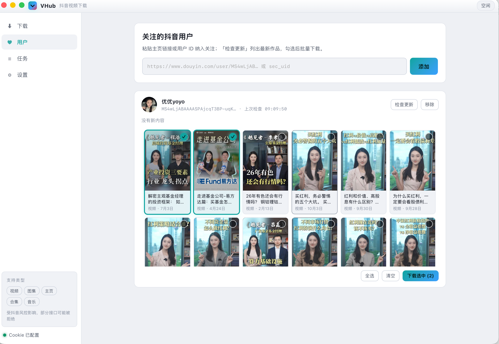
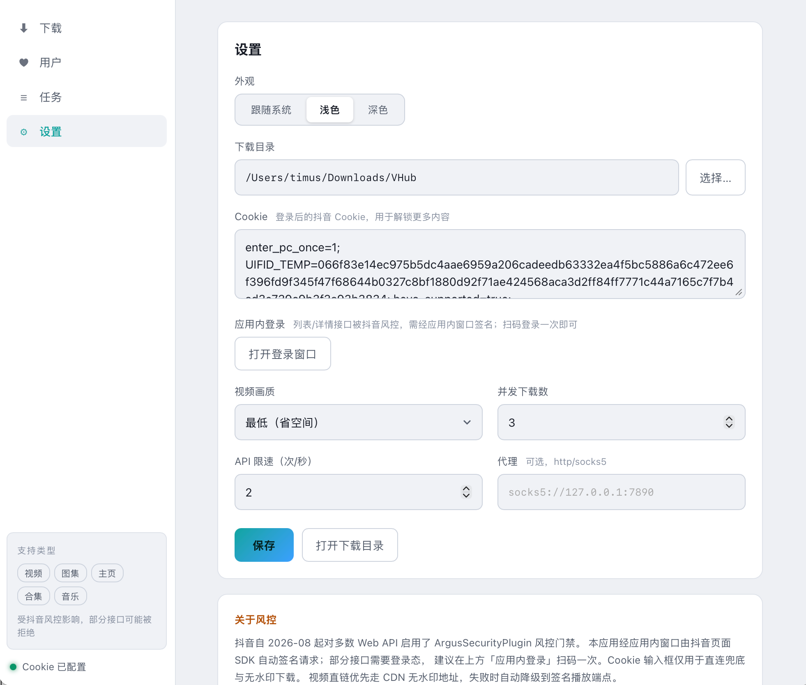

# VHub

抖音视频/图集下载工具 — 纯 Go 实现，UI 基于 [MyGo](../mygo)（系统 webview + 类型化 Go ↔ TypeScript IPC）。

## 功能

- 粘贴分享文本批量解析：单视频、图集、用户主页、合集、音乐页
- 用户管理：主页任务自动纳入关注列表（`users.json` 持久化）；「检查更新」增量拉取最新作品（标记新增），封面卡片勾选后批量下载
- 无水印优先：CDN `watermark=0` 直连 → 签名 `/aweme/v1/play/` 端点 → 构造签名地址 → 带水印兜底
- 反风控姿态（移植自参考实现）：
  - **X-Bogus** 每次请求重签（MD5 + RC4 + 自定义字符表，UA 一致）
  - **msToken** 优先走 mssdk 真实生成（内置 f2 快照配置），失败回退随机 token
  - 限速器 + 随机抖动（默认 2 req/s，可调）
  - 1s/2s/5s 退避重试；403/429/空 200 视为瞬时风控换新签名重试
  - `ArgusSecurityPlugin` 403 识别为确定性拒绝，立即失败不盲重试
  - `status_code=2483` / "请先登录" 识别为登录态失效
- 任务队列：并发下载（可调）、实时进度、失败重试、按作者分目录
- 设置持久化（`~/Library/Application Support/VHub/settings.json`）：下载目录、Cookie、代理、画质、并发、限速

## 截图

| 用户管理：检查更新，封面卡片勾选下载 | 设置：Cookie / 画质 / 并发 / 代理 |
|---|---|
|  |  |

## 已知限制

抖音自 2026-08 起对 `aweme/detail`、`aweme/post`、`mix/*`、`music/*` 等接口启用 ArgusSecurityPlugin 页面签名门禁，**纯 HTTP 请求会被确定性 403**。本应用内置 page bridge（隐藏 webview 加载 douyin.com，由页面 SDK 自动签名）已覆盖该门禁；部分接口仍需登录态，可在设置里打开应用内登录窗口扫码一次。A-Bogus 签名未移植。

## 开发

```sh
npm install          # 前端依赖（vite + mygo-runtime）
go run .             # 需先 npm run build:web（dist 会被 embed）
go run ../mygo/cmd/mygo dev .     # 开发模式：Vite 热更新 + 窗口
go run ../mygo/cmd/mygo build .   # 产物在 build/darwin-arm64/（.app + .dmg）
```

## 测试

```sh
go test ./...                    # 单测（签名/解析/媒体选取/队列/绑定签名）
go vet ./... && GOOS=linux go build ./... && GOOS=windows go build ./...
```

## 结构

```
main.go               应用入口：窗口、菜单、装配
frontend.go           embed dist/（go run/build 直接可用）
hub.go                Hub 服务：提交/任务表/重试/状态 → IPC 绑定
settings.go           Settings 服务：持久化配置 + 目录选择器
internal/douyin/
  xbogus.go           X-Bogus 签名（对照 utils/xbogus.py 移植）
  mstoken*.go         msToken 生成（内置 f2 配置快照）
  parse.go            URL 抽取/分类/短链还原（对照 core/url_parser.py）
  client.go           API client：签名、限速、重试、风控分流
  media.go            无水印候选排序、图集字段、流式下载（对照 downloader_base.py）
internal/queue/
  queue.go            任务队列：解析→并发下载→进度广播
src/
  main.ts style.css   前端 SPA（暗色商业风：下载/任务/设置三视图）
  mygo.ts             `mygo generate` 生成的类型化客户端（勿手改）
```
